  

<h1 data-importer="text" align="left">#WHOAMI</h1>

<h2 data-importer="text" align="left">#STATUS</h2>

  <svg class="pacman" viewBox="0 0 100 100" width="120" height="120" role="img">
    <path class="mouth-top" d="M 50 50 L 92 22 A 48 48 0 1 0 92 78 Z" fill="#FFD400" />
    <path class="mouth-bottom" d="M 50 50 L 92 78 A 48 48 0 0 1 92 22 Z" fill="#FFD400" />
    <circle cx="54" cy="24" r="6" fill="#111111" />
  </svg>

<picture data-importer="pacman">
  <source media="(prefers-color-scheme: dark)" srcset="https://raw.githubusercontent.com/rikardoplay/rikardoplay/pacman-output/pacman-contribution-graph-dark.svg?game=pacman">
  <source media="(prefers-color-scheme: light)" srcset="https://raw.githubusercontent.com/rikardoplay/rikardoplay/pacman-output/pacman-contribution-graph.svg?game=pacman">
  
</picture>

  

<h1 data-importer="text" align="left">#RESUMEN CLASES 📑</h1>
<h2>CLASE 1: HTML FUNDAMENTOS</h2>
Las webs se rigen por protocolo <b><i>HTTP (CLIENTE/SERVIDOR)</i></b>. Cuando el navegador pide un dominio <b>REQUEST</b> (Ejemplo <i>www.google.com</i>), el servidor responde y devuelve la web solicitada <b>[RESPONSE]</b> trayendo todo lo que ésta tiene: HTML, CSS, JAVA, etc.

<h2>LIBRERIA 📚​ ​vs FRAMEWORK 🛠️</h2>
 
Una librería como <b>REACT</b> es como una caja de herramientas ultra precisas que te permite construir interfaz de usuario (UI: USER INTERFACE),pero tu decides que colocar, que poner, tienes el control total.

FRAMEWORK como <b>ANGULAR</b>, es como una estructura pre-fabricada, trae todo para poner en funcionamiento la web pero se debe aprender muchas reglas puras y exclusivas de ese FRAMEWORK

<h2>HTML 📄</h2>
 
No es un lenguaje de programación matemático, es un lenguaje de etiquetas

DOM en HTML es (Modelo de Objetos del documento) es la representación en forma de árbol que crea el navegador. Es como INTERPRETA el navegador el archivo del HTML (HEAD, BODY, FOOT), que es cada cosa.

CSSOM es lo mismo que el DOM, pero con CSS. El navegador interpreta color, estilos y demás retoques. Juntos forman el layout.

<h2>ETIQUETAS 🔖</h2>
 
Una etiqueta es un elemento y la misma tiene 3 partes: 

Etiqueta de apertura        Contenido          Etiqueta de cierre

  ⬆️                                        ⬆️                           ⬆️  
< b>                              <b><i>Hola Mundo</i></b>                < /b>

<h2>RUTAS: RELATIVAS & ABSOLUTAS 📂</h2>
 
<h3>$RELATIVAS</h3>
Las rutas informan donde se deben de ir a buscar los archivos. La diferencia entre uno y otro está en en el punto de partida.
En rutas que dependen del <b>HTML</b> en relativas, se podria mostrar como ejemplo lo siguiente: 
<b>mi-primera-WEB/imagenes/logo.png</b>              🌄 
<b>mi-primera-WEB/sonidos/cancion-de-fondo</b>  🎵 
<b>mi-primera-WEB/videos/video-fondo</b>             🎞️ 

<h3>$ABSOLUTAS</h3>
Se utiliza este tipo de ruta para cargar recursos de otros servidores: Cuando usas imágenes, fuentes o estilos alojados en otro sitio web (por ejemplo, una imagen de Wikipedia), o también cuando se quiere llevar al usuario a otro sitio web (como Google, YouTube o una red social).

<h3>$VISUAL STUDIO CODE</h3>

Todo programador utiliza un programa para editar código, en nuestro caso utilizaremos el VISUAL STUDIO CODE propiedad de <b><i>Microsoft</i></b>

